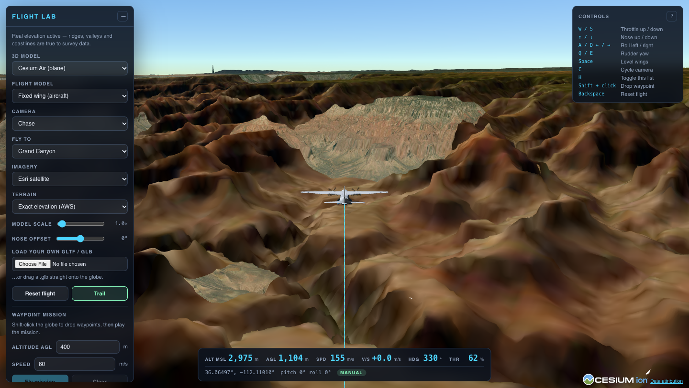

# Odesa trajectory replay

Run `npm run dev`, then open http://127.0.0.1:3000/. Choose a preset or edit
seed, starting coordinates, speed, heading, height and duration in the map's
**Configure run** panel. Click **Generate trajectory**, then **Play**.
Timing and turning options are available under the expandable settings.
Set Scenario ID and Object ID before generating. Download receiver ground truth
(`timestamp_s`, WGS84 `lat`/`lon`, ellipsoidal `hae_m`) or the full trajectory
with its resolved inputs and provenance.

Generation runs in a browser worker using the same engine as the CLI. No server
restart or JSON-file edit is needed between runs. `predev` and `prebuild` package
the local terrain and initial form defaults automatically; the built `dist/`
application can generate paths on static hosting (HTTPS or localhost is required
for the browser's checksum API). Editing a setting clears the previous run and
requires regeneration; invalid paths never become playable.
See [terrain documentation](terrain/README.md) for height conversion and limits.

The original simulator is preserved at `/scenario.html`; its documentation follows.

---

# MQ-9 Reaper Simulator

A CesiumJS simulation of a General Atomics MQ-9 Reaper flying over exact
worldwide terrain, with a camera you drive yourself.



- **The airframe, to published spec** — 20.1 m span, 11.0 m length, 50,000 ft
  ceiling, 400 km/h cruise, 482 km/h maximum, 27 h endurance on 1,800 kg of
  fuel. The glTF is generated at those exact dimensions.
- **A real flight model** — coordinated turns driven by bank angle, energy
  traded between speed and climb, and the sluggish roll and pitch rates a 4.7 t
  turboprop on a high aspect ratio wing actually has.
- **Live fuel and endurance** — burn is calibrated so cruise throttle empties
  the tanks over exactly the published 27 hours, with time compression up to
  60× so you can watch it happen.
- **Two cameras** — `follow` orbits the aircraft and travels with it, `free`
  detaches completely for six-degrees-of-freedom movement anywhere in the
  scene. `F` switches.
- **Exact terrain, no API key** — elevation from AWS Terrain Tiles, imagery
  from Esri.

Scope: this models flight performance and airframe geometry. The underwing
pylons are structural geometry — no weapons or targeting behaviour is simulated.

## Quick start

```bash
npm install   # copies Cesium's assets and generates the MQ-9 airframe
npm run dev   # http://localhost:3000
```

No API key required, including for terrain. It launches over Kyiv.

## Controls

| Key | Action |
|---|---|
| `F` | Switch follow / free camera |
| Drag mouse | Look around, or orbit the aircraft in follow |
| Wheel | Movement speed (free), or follow distance |
| `W` `A` `S` `D` | Move and strafe — free camera |
| `E` / `Q` | Up / down — free camera |
| `Shift` | Boost ×4 |
| `G` | Face the aircraft |
| `[` / `]` | Commanded altitude, up to the service ceiling |
| `T` | Time compression — 1×, 5×, 20×, 60× |
| `Backspace` | Relaunch |
| `H` | Toggle the control list |

The aircraft flies itself on a banked circuit at the commanded altitude; you
are an observer, not the pilot.

## Project layout

| File | Role |
|---|---|
| `src/profiles.ts` | MQ-9 specification and performance envelope |
| `src/sim.ts` | Flight dynamics, fuel burn, terrain clamping |
| `src/autopilot.ts` | Holds the circuit and commanded altitude |
| `src/camera.ts` | Follow and free camera rig |
| `src/vehicle.ts` | Aircraft entity, flown track, ground tether |
| `src/viewer.ts` | Imagery and terrain catalogs, scene tuning |
| `src/terrain.ts` | Keyless worldwide elevation from AWS Terrain Tiles |
| `scripts/make-mq9.mjs` | Generates the airframe glTF at published dimensions |

## Things worth knowing

**Where the numbers come from.** Throttle maps linearly from stall to maximum
speed, so cruise throttle is set to `(111 - 46) / (134 - 46)` — the fraction
that lands on 400 km/h. Fuel burn is normalised so that same setting burns
exactly `1800 / 27` kg per hour. Change one and the other has to follow.

**Model orientation.** Cesium maps a glTF's `+Z` axis onto its local `+X`, and
at `heading = 0` that points *east*, not north. Compass bearings therefore need
`hpr.heading = bearing - π/2`, which is what `noseOffset` carries. The generated
airframe is built nose-along-`+Z` to match.

**Terrain heights.** `globe.getHeight()` interpolates over whatever tile is
loaded, and a coarse tile can report the sea floor under dry land while tiles
stream in. The sampler rejects anything outside Earth's elevation range, and the
simulation slew-limits the estimate by how fast real ground could change at the
aircraft's speed.

**Loading speed.** The bundled Natural Earth basemap paints a complete world on
frame one with streamed imagery composited over it, request concurrency is
raised from Cesium's HTTP/1.1-era default of 6 per host to 18, and shadow maps
are off. The loading overlay clears once the tile queue drains to a
nearly-complete base — it never reaches zero while the aircraft is moving.

## Build

The offline Odesa elevation package and synthetic trajectory engine live in
[`terrain/`](terrain/README.md). Run `npm run trajectory:generate` to create
`terrain/generated/trajectory_truth.json`, `npm run terrain:validate` to check
inputs and assets, and `npm run terrain:test` for engine tests. The default browser page replays this engine's output over the local Odesa DSM.

```bash
npm run typecheck
npm run build     # -> dist/
npm run preview
```

Attribution: the in-app credit line carries the required notices and must stay
visible — imagery © Esri/Maxar, elevation from AWS Terrain Tiles, Natural Earth
basemap via Cesium. These are shared public endpoints; point them at your own
keys or tile cache before putting this in front of real users.
